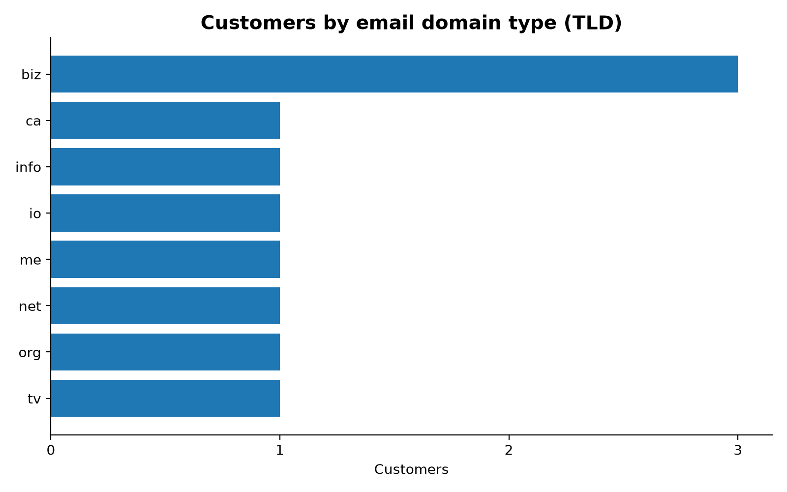

# Pesa Pulse: Where Are Our Customers?

A Python data-exploration project for **Pesa Pulse**, a Nairobi fintech start-up that has signed a partner sharing its customer directory through an API. Before marketing plans regional campaigns, they need the basics: how many customers there are, where they are, and what the data looks like.

The project pulls the data from the API, explores its nested structure, extracts the attributes that matter, and answers "where are our customers?" first with plain Python structures and then with pandas. It finishes with charts that can go straight into a slide.

## What this project demonstrates

| Skill | Where it is used |
|---|---|
| Requests and APIs | `get_customers()` fetches JSON with a timeout and handles failures |
| JSON and nested data | `explore()` and `extract_attributes()` navigate dicts inside dicts |
| Sets | `unique_cities()` finds distinct cities |
| Dictionaries and comprehensions | `city_counts()`, `email_domain_counts()`, `tld_counts()` |
| pandas | `to_dataframe()`, `value_counts()` cross-check, CSV export |
| Data visualisation | `plot_distribution()` saves bar charts with matplotlib |

## Project structure

```
Analysis_API/
├── analysis.py        # all the code
├── README.md
└── output/            # created when the script runs
    ├── customers.csv
    ├── city_counts.csv
    ├── customer_distribution.png
    └── customer_distribution_tld.png
```

## Getting started

```powershell
# 1. Create and activate a virtual environment (Windows PowerShell)
python -m venv .venv
.venv\Scripts\Activate.ps1

# 2. Install dependencies
pip install requests pandas matplotlib

# 3. Run
python analysis.py
```

## How it works

1. **Retrieve.** `get_customers(url)` calls `https://jsonplaceholder.typicode.com/users` with a 10-second timeout. Network errors and non-success responses print a clear message and return an empty list instead of crashing.
2. **Explore.** `explore(record, indent)` walks one record recursively and prints every key with its Python type, indented by depth.
3. **Extract.** `extract_attributes(customers)` flattens each nested record into one dict with: `id`, `name`, `username`, `email`, `email_domain`, `phone`, `city`, `zipcode`, `latitude`, `longitude`, `company`, `website`. Latitude and longitude are converted to floats.
4. **Unique cities.** `unique_cities(customers)` uses a set comprehension. Comparing its size with the number of customers shows whether city can group customers at all.
5. **Count.** `city_counts()` uses a plain loop with `dict.get()` (no `collections.Counter`, no pandas). `email_domain_counts()` and `tld_counts()` use dict comprehensions. Results are printed from most to least common, with ties broken alphabetically.
6. **pandas.** `to_dataframe(rows)` builds the DataFrame. The script prints its shape and `dtypes`, then asserts that `value_counts()` matches the hand-written counts.
7. **Export.** Writes `output/customers.csv` and `output/city_counts.csv` without the pandas index.
8. **Visualise.** `plot_distribution(counts, path, title)` saves horizontal bar charts, one by city and one by email TLD.

## The data structure

Each customer record is a nested dictionary:

```
id, name, username, email, phone, website   -> flat values
address (dict)
├── street, suite, city, zipcode
└── geo (dict)
    └── lat, lng                            -> strings in the API
company (dict)
└── name, catchPhrase, bs
```

The nested attributes are `address`, `address.geo` and `company`. The deepest value is reached with:

```python
customer["address"]["geo"]["lat"]
```

That is three levels deep. The API returns coordinates as strings, so they are converted with `float()`.

## Findings

Using the JSONPlaceholder sample data:

- **10 customers, 10 unique cities.** Every customer is in a different city, so city alone cannot group customers. Marketing needs a broader grouping, such as region or country, before it can plan regional campaigns.
- **Email domains are also all unique**, so a chart by full domain is as flat as the city chart.
- **Email TLD is the more informative chart.** `.biz` appears three times and every other TLD once, so it shows some variation. It is still only a weak proxy for geography.



## Limitations

- JSONPlaceholder is a **fake-data service**. Names, cities and coordinates are randomly generated, and the coordinates are scattered worldwide, not concentrated in Kenya. These results show that the pipeline works; they are not real insights about Pesa Pulse customers.
- Once the partner's real API is available, change `API_URL` and re-run. The code does not assume 10 records.
- `email_domain_counts()` rescans the list once per domain, which is fine at this size but slower than a single-pass loop on very large datasets.

## Possible next steps

- Group customers by region or country using the latitude and longitude values.
- Plot customers on a map.
- Add automated tests for the counting functions.
- Cache the API response to avoid repeated network calls while developing.

## Tech stack

Python, requests, pandas, matplotlib

